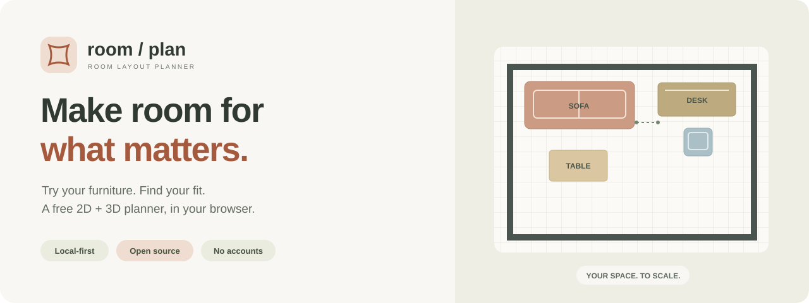
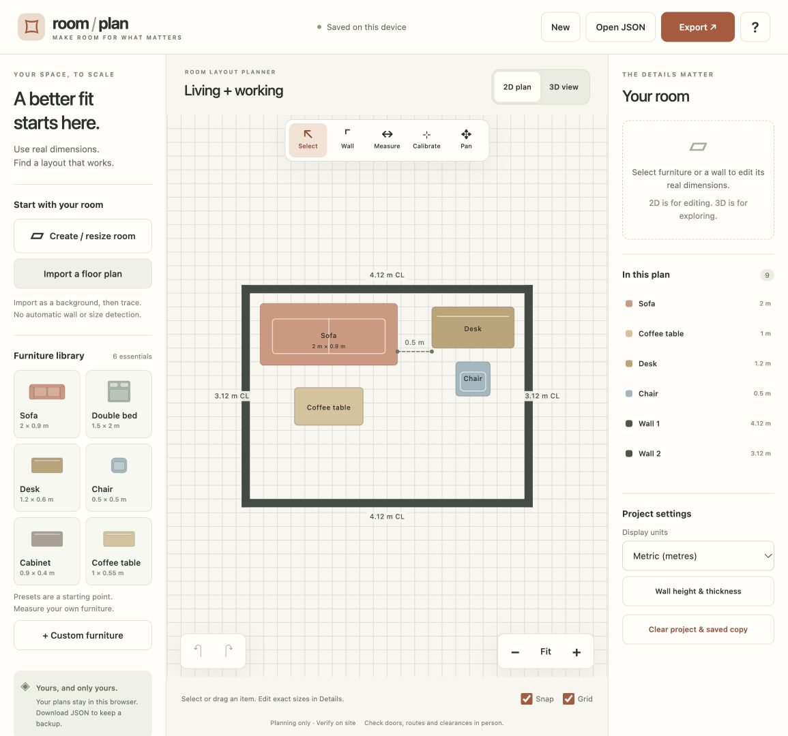
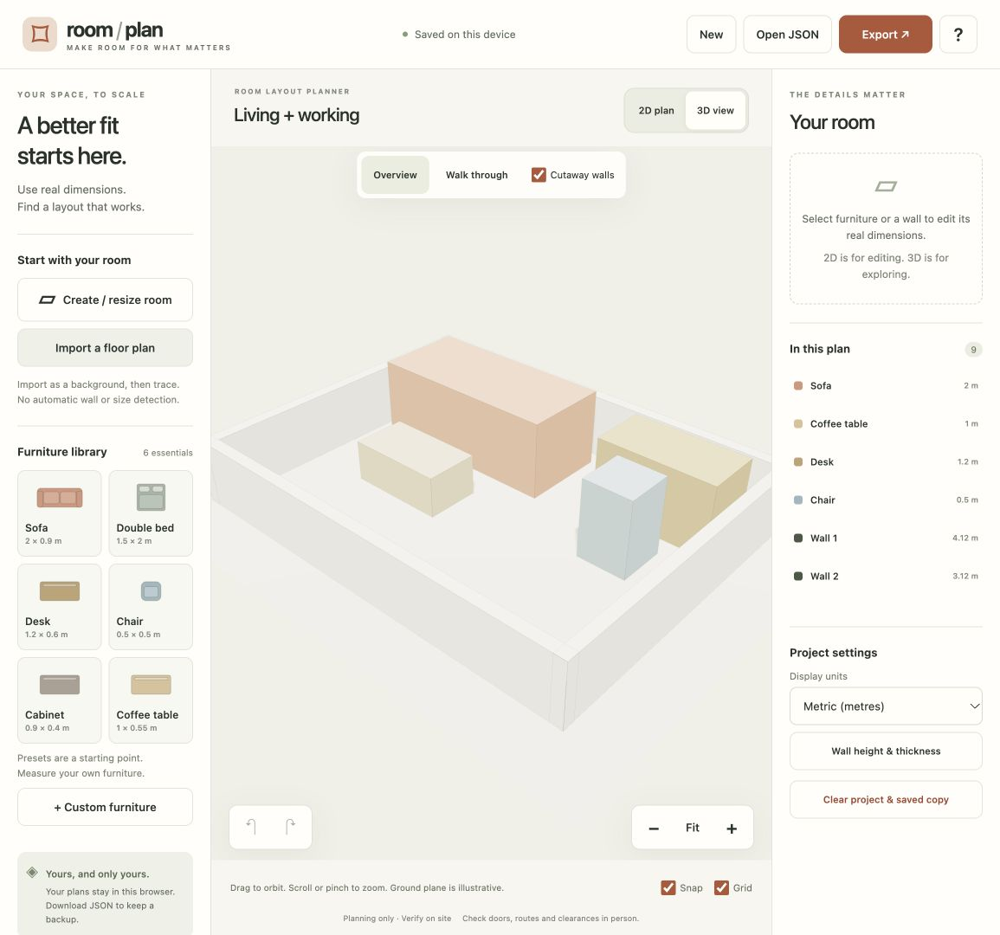

# Room Layout Planner

**Find a furniture layout that fits, before you move.**

[中文说明](README.zh-CN.md) · [Quick start](#quick-start) · [User guide](docs/USER_GUIDE.md) · [Contribute](CONTRIBUTING.md) · [MIT license](LICENSE)



A free, local-first **2D & 3D room planner**. Draw a room, try furniture at its real
size, and explore the result in 3D. Start with a blank room or an editable example;
you can also import a floor-plan image and trace it to scale.

**No account or subscription.** Your images and plans stay in your browser.
Save JSON to keep editing, or export PNG to show your layout.

> **0.1.0 · Development preview.** The screenshots below are from a local run.
> See the [local test record](docs/TESTING.md). Real-device and other-browser acceptance is pending.

## See it in action

| Arrange in 2D | Explore in 3D |
| --- | --- |
|  |  |
| Drag furniture and edit exact dimensions. | Orbit, zoom, or try the basic walk-through. |

The example is a **4 × 3 m room measured between inside wall faces**.
The 3D furniture uses simple boxes; the ground plane is illustrative.

## A small tool for a practical question

**Will this layout work in my room?** Use your measurements to try a sofa, bed,
desk, chair, cabinet or coffee table, then adjust and compare your options.

| What you can do | How it helps |
| --- | --- |
| **Start to scale** | Create a rectangular room using inside dimensions, or calibrate an imported PNG/JPEG with a known distance. |
| **Use your furniture sizes** | Six editable presets plus custom items; set width, depth, height, position and angle. |
| **Arrange and measure** | Drag, rotate, duplicate, draw straight walls and measure point-to-point distances. |
| **Switch perspective** | Linked 2D editing and read-only 3D overview with basic walk controls. |
| **Keep your work** | Device-local autosave, 60-step undo/redo, validated JSON import/export and 2D PNG export. |
| **Choose your units** | Metric or separate feet/inches fields; switching units preserves the actual geometry. |
| **Use your language** | Six languages across controls, help, errors, canvas labels and PNG exports. Switch without losing a draft. |

## Quick start

Clone the repository and start a local server:

```sh
git clone https://github.com/chr-kelly/room-layout-planner.git
cd room-layout-planner
python3 scripts/vendor.py
python3 scripts/vendor.py --check
python3 -m http.server 8000 --bind 127.0.0.1
```

Open **http://127.0.0.1:8000**, then choose **Try an example**.

1. **Set up your room.** Enter inside dimensions, or import a plan and calibrate a measured distance.
2. **Try a layout.** Add furniture, enter its actual size, then drag and rotate it into place.
3. **Review and save.** Explore in 3D, export PNG, and download JSON to keep an editable backup.

Python 3 is sufficient to serve the app; there is no application build step.
The first command downloads pinned Three.js files from the official upstream
and verifies SHA-256 hashes. If the files are already present, you can skip it
and run the second command to verify them. Node 20+ is needed only for development tests,
regenerating translated HTML entries, or preparing a deployment folder.

### Local setup and offline use

This project is a source distribution. Dependency files must be present before
3D can work; `scripts/vendor.py` downloads the pinned files. Downloading requires
internet access, but the app uses local dependencies rather than a runtime CDN.
If setup fails, the script reports an error; 2D editing can still work without 3D.

Serve the folder over HTTP. Double-clicking `index.html` is not supported because
browsers restrict ES modules under `file://`.

After downloading the files, you can run the folder through a local static server
without an external internet connection. An online hosted copy is not a
service-worker/PWA offline installation.

## Your data stays with you

No application backend, accounts, analytics, ads, remote fonts or AI API.
The application does not upload your image or plan. A hosting provider may log
ordinary page requests. [Privacy and data limits](docs/PRIVACY.md).

**Download JSON backups.** Autosave belongs to the current browser and site.
Images remain in session memory by default; reselect them after a reload, or
include the image in a JSON export. Browser storage does not sync between devices.

### Dimensions, images and current limits

- Geometry is stored in metres. Unit changes never rescale it.
- **CL** wall labels show centerline length, not clear inside dimensions.
- Background recalibration does not rescale existing walls or furniture.
- Same-size replacement images still require explicit confirmation of alignment.
- Single floor, straight walls and rectangular furniture; no door/window model,
  PDF import, automatic recognition, cost estimate, multiplayer or cloud sync.
- PNG/JPEG and JSON inputs: at most 10 MiB each; images: at most 16 million pixels.
  Embedded background images: at most 2 MiB. Walls, furniture and measurements:
  at most 200 each. Refreshing clears undo history.
- 3D cutaway lowers walls visually without changing stored height. The walk mode
  does not check collision, access or clearance. Furniture overlap is not validated.
- Clearing browser data, private browsing, storage quotas or changing the site
  or port may affect recovery. Keep backups outside the browser.

**Planning only · Verify on site.** Check actual furniture, walls, doors, lifts,
routes and clearances. This tool does not assess construction, structures,
regulatory compliance, delivery access or safety.

## Languages

Choose a language in the header or welcome dialog. Controls, help, errors, canvas
labels and PNG exports follow your choice. Units are independent of language;
decimal points and decimal commas are both accepted in numeric fields.

| Language | Entry path |
| --- | --- |
| English | `/` |
| 繁體中文 | `/zh-TW/` |
| 日本語 | `/ja/` |
| Deutsch | `/de/` |
| Français | `/fr/` |
| Español | `/es/` |

Switching updates the interface in place and remembers your preference. Your
plan, selection, undo history and unsubmitted inputs stay intact. Custom names
and names in older JSON files stay exactly as written; newly created default
names follow the interface language. A [Chinese guide](README.zh-CN.md) is available.

For translation changes, edit `src/locales/`, run `node scripts/build-pages.mjs`,
and run the tests. See [contributing](CONTRIBUTING.md).

## Self-hosting

The app consists of static files and can be hosted on **Cloudflare Pages** or
another static host with JavaScript module MIME types. Prepare the deployment folder:

```sh
python3 scripts/package.py --fetch-vendor
```

Upload the generated **`site/` folder** to Pages. It includes all six language
entries and local dependencies, and excludes docs, tests, Git data and environment
files. With Git integration, use framework preset **None**, build command
`python3 scripts/package.py --fetch-vendor`, and output directory **`site`**.
See [deployment instructions](docs/DEPLOYMENT.md) and
[Cloudflare's static HTML guide](https://developers.cloudflare.com/pages/framework-guides/deploy-anything/).

The included [GitHub Pages workflow](.github/workflows/pages.yml) downloads and
verifies dependencies and packages only app assets. It is manually triggered;
repository Pages must be configured to use GitHub Actions. It is a separate
hosting option from Cloudflare Pages.

**No public demo is published by this delivery.** The GitHub workflows have not
run. A workflow file or local screenshot is not a verified online deployment.

## Development and contributing

Keep the app static and local-first. See [contributing](CONTRIBUTING.md),
[architecture](docs/ARCHITECTURE.md), [user guide](docs/USER_GUIDE.md) and
[security](SECURITY.md).

```sh
node --test tests/*.test.js
python3 scripts/vendor.py --check
python3 -m pip install -r requirements-test.txt
python3 -m playwright install chromium
python3 tests/browser_test.py
```

The browser suite manages its own local server. `CHROMIUM_PATH` can select an
installed Chromium. Actual results and screenshots are written to `test-results/`.
Authored coverage and completed runs are recorded separately in [TESTING](docs/TESTING.md).

### Project structure

```text
index.html                App entry and accessible controls
zh-TW/ ja/ de/ fr/ es/    Generated static language entries
src/model.js              Validation, geometry, units and history
src/i18n.js               In-place language switching and text bindings
src/locales/              Six complete language catalogues
src/app.js                Editing, dialogs, gestures and lifecycle
src/viewport.js           2D canvas, hit tests and PNG export
src/scene3d.js             Lazy Three.js overview and walk controls
src/images.js             Image validation, decoding and compression
src/storage.js            Failure-aware localStorage adapter
vendor/three/             Pinned runtime dependencies and MIT license
examples/                 Editable example and calibration fixture
assets/readme/            Original banner and real local screenshots
scripts/                  Verified dependencies, HTML entries and static packaging
.github/workflows/        Tests and manual GitHub Pages deployment
```

## License and credits

Original implementation: **[MIT](LICENSE)**. Three.js and its controls retain
their upstream MIT license. [Third-party notices](THIRD_PARTY_NOTICES.md).

Inspired by [wy51ai/floorplan-3d](https://github.com/wy51ai/floorplan-3d). This project
independently implements manual tracing and local-image calibration rather than
reusing that project's fixed apartment data.
